# AI Dev Workflow

> An AI-assisted software development workflow that manages work from **idea → ticket → implementation → review** while keeping important decisions under human control.

This repository contains the implementation and experiments for two connected workflows:

1. **AI-Powered Idea-to-Ticket Workflow**
2. **Multi-Agent Automated Coding Workflow**

The goal is not simply to use AI to write code.  
The goal is to build a controlled development system where AI can help capture, organise, implement, test, and review work without automatically turning every idea into a code change.

---

# Table of Contents

- [1. Project Overview](#1-project-overview)
- [2. Why This Project Exists](#2-why-this-project-exists)
- [3. Overall Architecture](#3-overall-architecture)
- [4. Public and Private Repository Boundary](#4-public-and-private-repository-boundary)
- [5. Idea-to-Ticket Workflow](#5-idea-to-ticket-workflow)
- [6. Multi-Agent Coding Workflow](#6-multi-agent-coding-workflow)
- [7. Human Approval Boundaries](#7-human-approval-boundaries)
- [8. Repository Structure](#8-repository-structure)
- [9. Folder Explanations](#9-folder-explanations)
  - [9.1 `idea_to_ticket/`](#91-idea_to_ticket)
  - [9.2 `orchestrator/`](#92-orchestrator)
  - [9.3 `prompts/`](#93-prompts)
  - [9.4 `schemas/`](#94-schemas)
  - [9.5 `tests/`](#95-tests)
  - [9.6 `.ai/`](#96-ai)
  - [9.7 `docs/setup/`](#97-docssetup)
  - [9.8 `docs/explanations/`](#98-docsexplanations)
  - [9.9 `docs/architecture/`](#99-docsarchitecture)
  - [9.10 `examples/`](#910-examples)
- [10. Important Files](#10-important-files)
- [11. Current Development Roadmap](#11-current-development-roadmap)
- [12. Stage 1 — Repository Foundation](#12-stage-1--repository-foundation)
- [13. Stage 2 — Idea-to-Ticket MVP](#13-stage-2--idea-to-ticket-mvp)
- [14. Stage 3 — GitHub Integration](#14-stage-3--github-integration)
- [15. Stage 4 — Multi-Agent Coding MVP](#15-stage-4--multi-agent-coding-mvp)
- [16. Stage 5 — Connect the Two Workflows](#16-stage-5--connect-the-two-workflows)
- [17. Stage 6 — Advanced Automation](#17-stage-6--advanced-automation)
- [18. Tooling Strategy](#18-tooling-strategy)
- [19. Setup](#19-setup)
- [20. Basic Usage](#20-basic-usage)
- [21. Ticket Types](#21-ticket-types)
- [22. Priority Model](#22-priority-model)
- [23. Structured Ticket Model](#23-structured-ticket-model)
- [24. GitHub Project States](#24-github-project-states)
- [25. Testing and Definition of Done](#25-testing-and-definition-of-done)
- [26. Security and Secrets](#26-security-and-secrets)
- [27. Relationship with `AGENTS.md`](#27-relationship-with-agentsmd)
- [28. Documentation Layout](#28-documentation-layout)
- [29. Example End-to-End Flow](#29-example-end-to-end-flow)
- [30. Long-Term Goal](#30-long-term-goal)
- [31. Core Principles](#31-core-principles)

---

# 1. Project Overview

This repository is an experimental AI development workflow project.

It is intended to be publishable as a **public repository** containing generic framework code, documentation, schemas, tests, examples, and architecture. Sensitive project integrations and private operational context belong in a separate private integration layer.

It is designed to answer three questions:

1. Can AI help turn a small rough idea into a useful, structured ticket before coding starts?
2. Can AI analyse a large design, requirements document, architecture document, or specification and propose a traceable work breakdown such as Epic → Story → Task?
3. Once approved work is ready, can multiple AI agents collaborate through planning, implementation, testing, and review?

The intended end-to-end flow is:

```text
Idea / Design / Specification
  ↓
AI Intake
  ↓
Understand Scope
  ↓
┌─────────────────────────────┐
│ Small / Focused Input       │
│   ↓                         │
│ Single Ticket Draft         │
│                             │
│ Large / Complex Input       │
│   ↓                         │
│ Work Breakdown              │
│   ↓                         │
│ Epic / Story / Task /       │
│ Research / Other Work       │
└─────────────────────────────┘
  ↓
Schema Validation
  ↓
Human Review
  ↓
GitHub Integration
  ↓
Ready Gate
  ↓
Planner / Architect
  ↓
Developer
  ↓
Tester / Integration
  ↓
Independent Reviewer
  ↓
Pull Request
  ↓
Human Review
  ↓
Merge
```

A key design rule is:

```text
AI decomposition
≠ approval
≠ Ready status
≠ permission to start coding
```

This repository is **not** intended to contain MarketLens production code.

A project such as MarketLens may later become a real consumer of this workflow.

Detailed Idea-to-Ticket architecture lives in:

```text
docs/architecture/idea-to-ticket-workflow.md
```

---

# 2. Why This Project Exists

The main problem is not a lack of ideas.

The problem is that new ideas can interrupt the work already in progress.

Without a controlled workflow:

```text
New idea
  ↓
Stop current work
  ↓
Start coding the new idea
  ↓
Another idea appears
  ↓
Change direction again
```

The target behaviour is:

```text
New idea
  ↓
Capture it
  ↓
AI organises it
  ↓
Human reviews it
  ↓
Backlog remembers it
  ↓
Current work continues
```

The second problem is repetitive manual coordination between AI tools.

Instead of repeatedly copying requirements between different tools, the long-term goal is:

```text
Approved GitHub Issue
  ↓
Orchestrator
  ↓
Planner
  ↓
Developer
  ↓
Tester
  ↓
Reviewer
  ↓
Pull Request
```

---

# 3. Overall Architecture

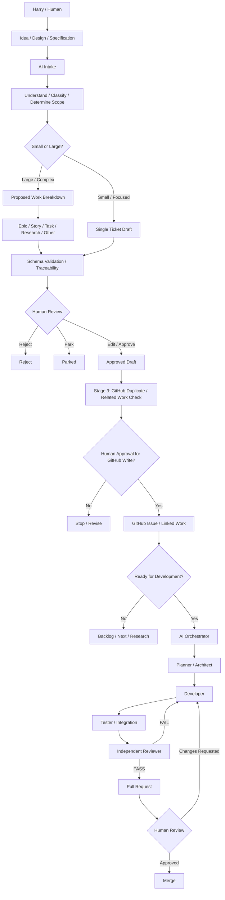

The most important boundaries are:

```text
AI Draft / Decomposition
        ↓
Human Review
        ↓
GitHub Write Approval
        ↓
GitHub Work
        ↓
Human Ready Decision
        ↓
Coding Workflow
```

The **Idea-to-Ticket workflow** prepares structured work before coding.

The **GitHub Integration stage** performs duplicate / related-work checks and GitHub writes only after explicit human approval.

The **Multi-Agent Coding workflow** begins only when work is explicitly considered ready for implementation.

Capturing or decomposing an idea does not authorise implementation.

---

# 4. Public and Private Repository Boundary

This repository is intended to be safe to publish as a **public framework, learning project, and portfolio repository**.

The public repository should contain only generic and reusable material:

```text
PUBLIC
ai-dev-workflow
│
├── README.md
├── AGENTS.md
├── CLAUDE.md
├── docs/
├── architecture diagrams
├── generic schemas
├── generic tests
├── examples/
├── prompts/
└── generic orchestrator code
```

Project-specific or sensitive integrations belong outside this public repository.

```text
PRIVATE INTEGRATION LAYER
│
├── private repository adapters
├── internal configuration
├── real project context
├── private test data
└── deployment-specific configuration
```

Secrets should not be committed to either public or private repositories.

```text
Never commit:
.env
API keys
access tokens
passwords
private certificates
production credentials
```

Use environment variables, GitHub Secrets, or an appropriate secret manager instead.

The intended relationship is:

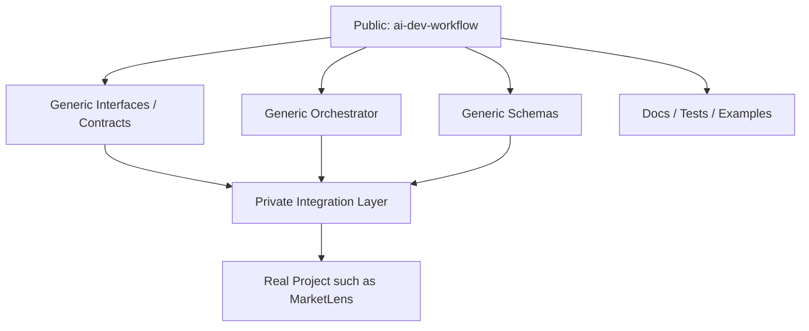

The public README should document this boundary at a high level, but it should **not** expose:

- private repository names or URLs
- private company information
- private production endpoints
- real credentials
- customer data
- internal operational details

A useful rule is:

> If publishing a file could create security, privacy, company, or production risk, it does not belong in the public repository.

---

# 5. Idea-to-Ticket Workflow

The first workflow focuses on understanding and organising work **before coding starts**.

It supports two input shapes.

### Small / focused input

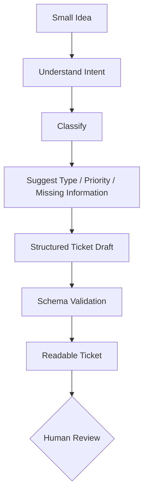

### Large / complex input

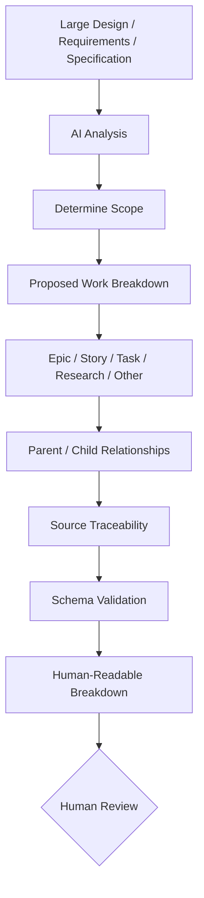

The AI may help with:

- understanding the input
- classification
- identifying missing information
- suggesting priority
- drafting a single ticket
- proposing Epic / Story / Task decomposition for large inputs
- suggesting Research, Experiment, Architecture, Data, Bug, Refactor, or Documentation work
- preserving source context for generated work items
- generating structured output

The AI must not automatically:

- create or modify GitHub Issues during Stage 2
- search GitHub Issues during Stage 2
- mark work as `Ready`
- start implementation
- change production code
- merge code
- deploy code

Duplicate / related GitHub Issue search belongs to **Stage 3**, not Stage 2.

Detailed rules for small-vs-large input behaviour are defined in:

```text
docs/architecture/idea-to-ticket-workflow.md
```

---

# 6. Multi-Agent Coding Workflow

Once an issue is approved and marked ready, the coding workflow begins.

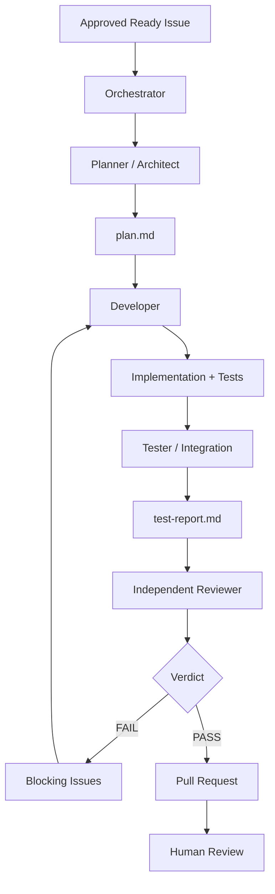

Initial role model:

```text
Planner / Architect
        ↓
Developer
        ↓
Tester / Integration
        ↓
Independent Reviewer
```

Current working role mapping:

```text
Harry           → Repository owner / final authority
ChatGPT / Codex → Planner / Architect
Cursor          → Current implementation / IDE / testing tool
Claude Code     → Optional implementation agent
Grok            → Independent reviewer (formal role later)
```

Cursor can implement the current Stage 2 work. Claude Code may be added later as an alternative implementation agent.

However, the architecture should still depend on **roles**, not permanently on specific vendors.

---

# 7. Human Approval Boundaries

Human control is a core design principle.

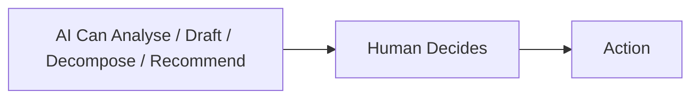

AI may:

```text
Analyse
Classify
Summarise
Draft
Decompose
Recommend
Implement approved work
Test
Review
```

The human remains responsible for:

```text
Approve
Reject
Park
Change hierarchy
Change priority
Approve GitHub writes
Mark Ready
Authorise development
Approve merge
Authorise deployment
```

A useful boundary is:

```text
Idea / Design
  ↓
AI Draft / Work Breakdown
  ↓
Human Review
  ↓
GitHub Integration
  ↓
Human Approval for Write
  ↓
GitHub Issue(s)
  ↓
Human Ready Decision
  ↓
Coding Workflow
```

The system must preserve:

```text
AI decomposition
≠ approval
≠ Ready status
≠ coding authorisation
```

---

# 8. Repository Structure

Recommended public repository structure:

```text
ai-dev-workflow/
│
├── idea_to_ticket/
├── orchestrator/
├── prompts/
├── schemas/
├── tests/
├── examples/
├── docs/
│   ├── setup/
│   ├── explanations/
│   └── architecture/
├── .ai/
│
├── AGENTS.md
├── CLAUDE.md
├── README.md
├── pyproject.toml
├── .gitignore
└── .env.example
```

Mermaid view:

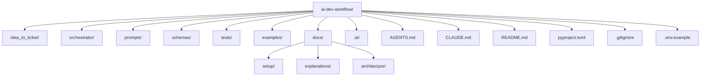

---

# 9. Folder Explanations

## 9.1 `idea_to_ticket/`

Purpose:

> Contains the local application logic for converting input into validated Idea-to-Ticket output.

Stage 2A–2B responsibilities include:

```text
Input handling
Prompt loading
Provider boundary
Single-ticket pipeline
Schema validation
Readable rendering
Fixture / CLI flow
```

Stage 2C may later add:

```text
Large-input scope detection
Work-breakdown generation
Hierarchy validation
Parent / child relationships
Source traceability
Human-readable hierarchy rendering
```

GitHub duplicate detection and GitHub Issue creation do **not** belong in the Stage 2 responsibilities of this package. Those are Stage 3 integration concerns.

Expected MVP files:

```text
idea_to_ticket/
├── __init__.py
├── idea.py
├── pipeline.py
├── provider.py
└── render.py
```

This is the first real application area developed in the project.

---

## 9.2 `orchestrator/`

Purpose:

> Coordinates the multi-agent coding workflow after an issue is ready for development.

Possible responsibilities:

```text
Read task
Invoke planner
Pass plan to developer
Run tester
Invoke reviewer
Handle PASS / FAIL
Control retry loops
Track execution state
```

Example future files:

```text
orchestrator/
├── runner.py
├── agents.py
├── workflow.py
├── retry.py
└── state.py
```

This folder should remain minimal until the Idea-to-Ticket workflow is stable.

---

## 9.3 `prompts/`

Purpose:

> Stores version-controlled prompts used by AI agents.

Instead of hiding important prompts inside Python strings, prompts can be stored separately.

Example:

```text
prompts/
├── idea_intake.md
├── ticket_classifier.md
├── planner.md
├── developer.md
├── tester.md
└── reviewer.md
```

Benefits:

- easier review
- easier version control
- easier prompt testing
- easier provider replacement
- easier comparison between prompt versions

---

## 9.4 `schemas/`

Purpose:

> Defines structured data models used between different parts of the workflow.

Example models:

```text
TicketDraft
WorkBreakdown (Stage 2C)
IssueSearchResult (Stage 3)
PlannerOutput
TestReport
ReviewResult
WorkflowRun
```

Possible structure:

```text
schemas/
├── ticket.py
├── planning.py
├── testing.py
└── review.py
```

Pydantic may be used where appropriate.

The goal is to avoid passing unreliable free-form text between automated stages.

---

## 9.5 `tests/`

Purpose:

> Contains automated tests for the workflow.

Example:

```text
tests/
├── test_intake.py
├── test_classifier.py
├── test_ticket_schema.py
├── test_duplicate_checker.py
├── test_github_client.py
└── test_orchestrator.py
```

Tests should verify behaviour rather than AI opinions.

Examples:

```text
Valid ticket output
Malformed model output
Missing fields
User rejects approval
GitHub command failure
Duplicate issue detection
Retry limit behaviour
```

---

## 9.6 `.ai/`

Purpose:

> Stores temporary or shared artefacts generated during an AI coding workflow run.

Example:

```text
.ai/
├── task.md
├── plan.md
├── implementation.md
├── test-report.md
└── review.md
```

Typical flow:

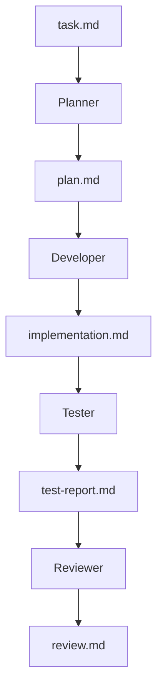

These files make agent handoffs visible and auditable.

Do not store secrets in `.ai/`.

---

## 9.7 `docs/setup/`

Purpose:

> Stores practical setup and implementation guides.

Example:

```text
docs/setup/
└── fresh-setup-guide.md
```

Use this folder for documents that answer:

```text
How do I install, configure, or build this?
```

---

## 9.8 `docs/explanations/`

Purpose:

> Stores human-readable Markdown documents that explain concepts, tools, and design principles.

Example:

```text
docs/explanations/
├── what-is-agents-md.md
├── what-is-claude-md.md
├── what-is-an-orchestrator.md
├── structured-output-explained.md
├── human-approval-boundaries.md
└── local-vs-cloud-models.md
```

Use this folder for documents that answer:

```text
What is this concept?
Why does it matter?
```

---

## 9.9 `docs/architecture/`

Purpose:

> Stores system design and architecture documentation.

Example:

```text
docs/architecture/
├── idea-to-ticket-workflow.md
├── multi-agent-coding-workflow.md
└── public-private-repository-boundary.md
```

This folder is appropriate for:

- component boundaries
- workflow handoffs
- Mermaid architecture diagrams
- design decisions

---

## 9.10 `examples/`

Purpose:

> Provides safe, generic examples that demonstrate how the workflow works without exposing real project data.

Example:

```text
examples/
├── sample-idea.md
├── sample-ticket.json
├── sample-plan.md
├── sample-test-report.md
└── sample-review.md
```

All examples should use fake or sample data.

Avoid real:

```text
emails
customer IDs
access tokens
private repository URLs
production payloads
company-sensitive data
```

---

# 10. Important Files

## `README.md`

Purpose:

> The front door of the project.

It explains:

- what the project is
- why it exists
- how it works
- repository structure
- setup
- usage
- roadmap

---

## `AGENTS.md`

Purpose:

> Project-wide operating rules for AI coding agents.

It defines:

- coding rules
- testing rules
- Git rules
- security rules
- human approval boundaries
- stage boundaries
- agent responsibilities

Simple distinction:

```text
README.md
= What this project is and how to use it

AGENTS.md
= How AI agents must behave while working in it
```

---

## `CLAUDE.md`

Purpose:

> Claude Code-specific entry point for this repository.

`CLAUDE.md` does not replace `AGENTS.md`.

The intended relationship is:

```text
AGENTS.md
= Vendor-neutral rules for all AI agents

CLAUDE.md
= Claude Code-specific entry point
```

Claude Code should read and follow:

```text
AGENTS.md
README.md
```

and, when a workflow task exists:

```text
.ai/task.md
```

`CLAUDE.md` may define Claude-specific behaviour, but repository-wide rules remain in `AGENTS.md`.

---

## `.env.example`

Purpose:

> Documents required environment variables without containing real secrets.

Example:

```text
OPENAI_API_KEY=
GITHUB_TOKEN=
```

Real secrets belong in:

```text
.env
```

and `.env` must not be committed.

---

# 11. Current Development Roadmap

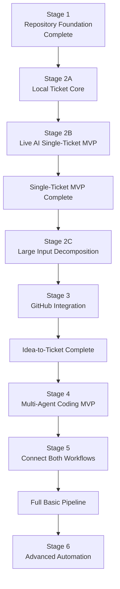

Rule:

> Complete and verify the current approved phase before moving to the next one.

Stage 2C is intentionally a separate extension so large-design decomposition does not overcomplicate the first single-ticket MVP.

---

# 12. Stage 1 — Repository Foundation

**Status: Complete ✅**

Goal:

```text
Create a clean project foundation.
```

Tasks:

```text
Create GitHub repository
Clone locally
Create folders
Add README.md
Add AGENTS.md
Add CLAUDE.md
Add docs/setup/
Add docs/explanations/
Add docs/architecture/
Add examples/
Add .gitignore
Add .env.example
Document the public/private boundary
Create first commit
Push baseline
```

Do not build the agent workflow yet.

Claude Code is optional in Stage 1 and is not required to complete the repository foundation.

Definition of Done:

```text
Repository exists
Git works
Main branch is clean
Project structure exists
Public/private boundary is documented
No secrets or private project data are committed
Baseline commit pushed
```

---

# 13. Stage 2 — Idea-to-Ticket MVP

Stage 2 is divided into three sub-phases.

## Stage 2A — Local Core

Goal:

```text
Structured Ticket Fixture
  ↓
Schema Validation
  ↓
Readable Ticket
```

Build the local core with:

```text
TicketDraft schema
Pydantic validation
Pipeline
Renderer
FakeDrafter
CLI
Automated tests
```

No live AI API is required.

Primary CLI:

```bash
python -m idea_to_ticket.idea --fixture examples/sample-ticket.json
```

Stage 2A is complete when automated tests pass and the fixture CLI works.

Stage 2A alone is **not** the single-ticket MVP.

## Stage 2B — Live AI Integration

Goal:

```text
Focused Raw Idea
  ↓
One Approved AI Provider
  ↓
Structured Ticket Draft
  ↓
Schema Validation
  ↓
Readable Ticket
```

Primary CLI:

```bash
python -m idea_to_ticket.idea
```

Example input:

```text
I want to investigate market breadth for MarketLens.
```

Only one approved provider should be implemented for the MVP.

Provider and model selection remain a human decision.

No GitHub search or write action belongs in Stage 2B.

Stage 2B is complete only after a successful manual live end-to-end run.

At that point the **single-ticket MVP is complete**.

## Stage 2C — Large Input Decomposition

Stage 2C is a planned extension for inputs such as:

```text
Large Product Design
Requirements Document
Architecture Document
Technical Specification
```

Target flow:

```text
Large Design / Specification
  ↓
AI Analysis
  ↓
Hierarchical Work Breakdown
  ↓
Epic / Story / Task / Research / Other Work
  ↓
Hierarchy Validation
  ↓
Source Traceability
  ↓
Human-Readable Proposed Breakdown
  ↓
Human Review
```

Stage 2C should define a separate `WorkBreakdown` schema rather than overloading `TicketDraft`.

Possible future hierarchy fields include:

```text
id
parent_id
work_item_level
children
dependencies
source_context
```

Stage 2C must preserve:

```text
AI decomposition
≠ approval
≠ Ready
≠ coding authorisation
```

Do not implement Stage 2C until its schema and decomposition policy are separately approved.

See:

```text
docs/architecture/idea-to-ticket-workflow.md
```

---

# 14. Stage 3 — GitHub Integration

Goal:

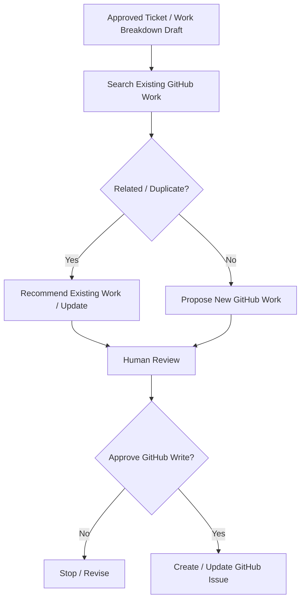

Suggested approval prompt:

```text
Create GitHub Issue? [y/N]
```

Default:

```text
No
```

No approval means no GitHub write.

Stage 3 is where duplicate / related-work search belongs.

For decomposed work, linked issues or sub-issues may be considered only after the Stage 2C hierarchy model is implemented and explicitly approved.

Human approval remains mandatory before creating or modifying GitHub Issues.

---

# 15. Stage 4 — Multi-Agent Coding MVP

Goal:

```text
task.md
  ↓
Planner
  ↓
Developer
  ↓
Tester
  ↓
Reviewer
```

First version should be sequential.

Do not start with parallel agents.

At Stage 4, role separation becomes an explicit part of the workflow.

Current recommended mapping:

```text
ChatGPT / Codex → Planner / Architect
Claude Code     → Primary Developer
Cursor          → Integration / Tester / IDE
Grok            → Independent Reviewer
```

The specific brands may change later. The workflow should continue to depend on roles and verification boundaries rather than one vendor.

---

# 16. Stage 5 — Connect the Two Workflows

Goal:

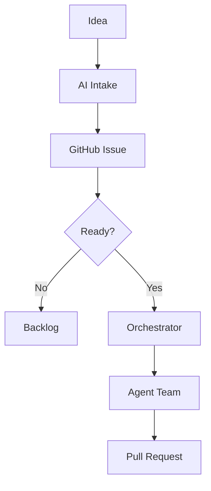

This creates the first complete end-to-end system.

Important rule:

> Creating an issue and starting implementation are two different decisions.

---

# 17. Stage 6 — Advanced Automation

Only after the basic workflow is stable.

Possible additions:

```text
Retry limits
Error handling
Structured JSON
Logging
Token tracking
Cost tracking
Run history
Git branches
Git worktrees
Parallel agents
CI feedback
Automated PR creation
```

Feedback loop:

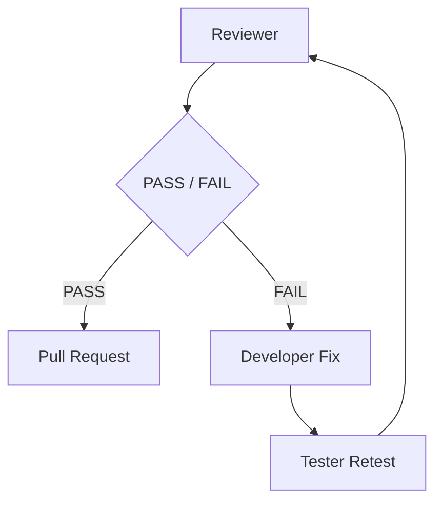

Only at the final stage consider:

```text
Auto merge
Auto deploy
Production changes
```

---

# 18. Tooling Strategy

Current working arrangement:

```text
Harry
→ Repository owner / final authority

ChatGPT / Codex
→ Planner / Architect

Cursor
→ Current implementation / IDE / testing tool

Claude Code
→ Optional implementation agent

Grok
→ Independent reviewer (formal role later)
```

Cursor can implement Stage 2A and Stage 2B.

Claude Code is **not required** to begin Stage 2. It may be introduced later as an alternative or additional implementation agent.

At Stage 4, roles become formal workflow contracts:

```text
Planner
Developer
Tester
Reviewer
```

Possible future tools:

```text
Claude Code
OpenCode
Ollama
Local models
Other coding agents
Other model providers
```

Important:

> The architecture should depend on roles and verification boundaries, not vendor names.

`AGENTS.md` remains the vendor-neutral rulebook.

`CLAUDE.md` is only the Claude Code-specific entry point when Claude Code is used.

---

# 19. Setup

Initial recommended environment:

```text
Python 3.12+
Git
GitHub CLI
VS Code or Cursor
```

Check versions:

```bash
python --version
git --version
gh --version
```

Optional implementation agent:

```text
Claude Code
```

Optional later:

```text
OpenCode
Ollama
```

Python environment example:

```bash
python -m venv .venv
```

Windows PowerShell:

```powershell
.venv\Scripts\Activate.ps1
```

Linux / WSL:

```bash
source .venv/bin/activate
```

Install dependencies later when `requirements.txt` or `pyproject.toml` is added.

---

# 20. Basic Usage

Stage 2A fixture mode:

```bash
python -m idea_to_ticket.idea --fixture examples/sample-ticket.json
```

Stage 2B live mode:

```bash
python -m idea_to_ticket.idea
```

or:

```bash
python -m idea_to_ticket.idea --idea "Investigate whether market breadth can improve signal quality."
```

Example interactive input:

```text
What is your idea?

> Investigate whether market breadth and the S&P 500 trend
  can improve signal quality.
```

Expected result:

```text
Type:
RESEARCH / EXPERIMENT

Priority:
NEXT

Development Ready:
No

Recommended Action:
Create research ticket
```

Stage 2C will later add large-document / specification input and hierarchical work-breakdown output.

---

# 21. Ticket Types

Initial supported types:

```text
FEATURE
BUG
RESEARCH
EXPERIMENT
DATA
ARCHITECTURE
REFACTOR
DOCUMENTATION
```

Do not automatically treat research as implementation work.

Example:

```text
Research
  ↓
Hypothesis
  ↓
Experiment
  ↓
Backtest / Evidence
  ↓
Decision
  ↓
Feature
```

---

# 22. Priority Model

Suggested priorities:

```text
NOW
NEXT
LATER
PARKED
```

AI may recommend priority.

The human decides final roadmap priority.

---

# 23. Structured Ticket Model

Suggested fields:

```text
title
type
project
priority
labels
problem
hypothesis
related_context
duplicate_of
missing_information
requires_experiment
ready_for_development
recommended_action
acceptance_criteria
```

Example:

```json
{
  "title": "Research Market Regime Detection",
  "type": "research",
  "project": "MarketLens",
  "priority": "next",
  "labels": [
    "research",
    "algorithm",
    "market-regime"
  ],
  "duplicate_of": null,
  "problem": "The scanner does not currently include an overall market regime filter.",
  "hypothesis": "A market regime filter may reduce poor-quality signals during weak markets.",
  "requires_experiment": true,
  "ready_for_development": false,
  "recommended_action": "Create research ticket"
}
```

Structured output should be validated before being used by automation.

For Stage 2A–2B, `TicketDraft` is the canonical single-ticket model and `duplicate_of` remains `null`.

Stage 2C should introduce a separate hierarchical model such as `WorkBreakdown`, with approved fields for parent / child relationships and `source_context` traceability. Do not force an entire Epic / Story / Task hierarchy into one `TicketDraft`.

---

# 24. GitHub Project States

Suggested work queue:

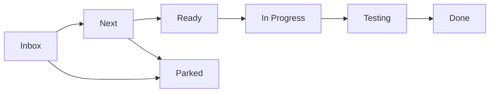

Meaning:

```text
Inbox
= Captured but not prioritised

Next
= Worth doing soon

Ready
= Approved and ready for implementation

In Progress
= Actively being worked on

Testing
= Implementation complete, validation in progress

Done
= Finished

Parked
= Keep the idea, but do not work on it now
```

---

# 25. Testing and Definition of Done

AI should not define completion only by saying:

```text
Done.
```

Use objective evidence.

Possible Definition of Done:

```text
Build passes
Tests pass
Lint passes
Type checking passes
Acceptance criteria satisfied
No unrelated changes
Independent review passes
```

Example test report:

```text
Build: PASS
Tests: 42 passed, 0 failed
Lint: PASS
Type check: PASS
```

---

# 26. Security and Secrets

Never commit:

```text
.env
API keys
GitHub tokens
Passwords
Private credentials
Access tokens
Certificates
```

Commit:

```text
.env.example
```

with placeholders only.

Do not print secrets into:

```text
Logs
Prompts
GitHub Issues
.ai files
Test reports
Screenshots
```

---

# 27. Relationship with `AGENTS.md`

`AGENTS.md` contains the operating rules for AI agents.

Simple model:

```text
README.md
  ↓
What is this project?

AGENTS.md
  ↓
How must all AI agents behave?

CLAUDE.md
  ↓
How should Claude Code enter and work in this repository?

.ai/task.md
  ↓
What are we doing now?

.ai/plan.md
  ↓
How will we do it?

.ai/test-report.md
  ↓
Did it work?

.ai/review.md
  ↓
Is it acceptable?
```

Agents should read `AGENTS.md` before working in the repository.

Claude Code should additionally use `CLAUDE.md` as its tool-specific entry point.

---

# 28. Documentation Layout

Documentation is grouped by purpose:

```text
docs/
├── setup/
├── explanations/
└── architecture/
```

Use:

```text
docs/setup/
= How do I install, configure, or build this?

docs/explanations/
= What is this concept and why does it matter?

docs/architecture/
= How is the system designed?
```

Examples:

```text
docs/setup/fresh-setup-guide.md
docs/setup/stage-2-idea-to-ticket-mvp-implementation-plan.md

docs/explanations/what-is-agents-md.md
docs/explanations/what-is-claude-md.md
docs/explanations/what-is-an-orchestrator.md
docs/explanations/idea-to-ticket-overview.md
docs/explanations/structured-output-explained.md
docs/explanations/human-approval-boundaries.md
docs/explanations/local-vs-cloud-models.md
docs/explanations/github-project-states.md

docs/architecture/idea-to-ticket-workflow.md
docs/architecture/multi-agent-coding-workflow.md
docs/architecture/public-private-repository-boundary.md
```

The README should remain the project front door rather than becoming the home for every detailed explanation.

---

# 29. Example End-to-End Flow

### Small input example

```text
I want to investigate using market breadth and
the S&P 500 trend to improve the scanner.
```

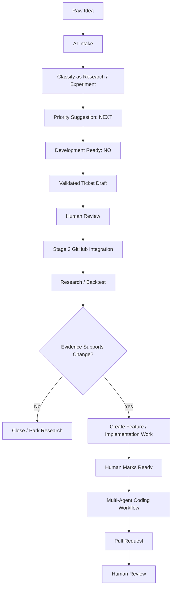

### Large input example

```text
Complete MarketLens design
```

may later produce:

```text
Epic: Market Data Platform
├── Story: Historical market data ingestion
├── Story: Local cache
└── Data: Historical backfill

Epic: Stock Screening
├── Story: VCP detection
├── Research: Confirm detection rules
└── Task: Add validation tests

Epic: Market Regime
├── Research: Evaluate indicators
└── Story: Classify market conditions
```

Every generated work item remains a proposal until human review.

This prevents both an untested idea and a large AI-generated decomposition from immediately changing production behaviour.

---

# 30. Long-Term Goal

The complete target system is:

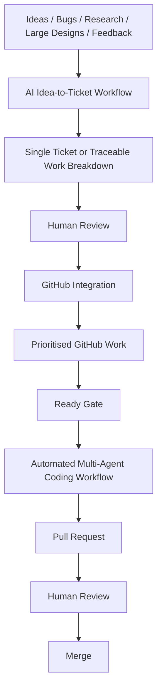

Eventually the workflow may support:

```text
Multiple repositories
Multiple AI providers
Different agent role assignments
Prompt versioning
Evaluation datasets
Cost tracking
Run history
CI feedback loops
Local models
Cloud models
Large-document ingestion
Requirement traceability
Dependency graphs
GitHub sub-issues / linked work
```

These should be added gradually.

---

# 31. Core Principles

## Principle 1

> **Capturing an idea must not automatically turn that idea into code.**

---

## Principle 2

> **Complete and verify one stage before moving to the next.**

---

## Principle 3

> **Roles and verification boundaries matter more than AI brand names.**

---

## Principle 4

> **Objective tests are more important than AI confidence.**

---

## Principle 5

> **Human approval remains the final authority for priority, readiness, merge, deployment, and production changes.**

---

## Principle 6

> **No AI agent is the repository owner. Human authority remains final.**

---

## Principle 7

> **AI decomposition is a proposal, not approval, Ready status, or permission to start coding.**

---

## Current Starting Point

Stage 1 is complete.

The current implementation target is:

```text
Stage 2A
  ↓
Build the local ticket core
  ↓
Schema + Validation + Renderer + Pipeline
  ↓
FakeDrafter + CLI + Tests
```

After Stage 2A is verified:

```text
Stage 2B
  ↓
Choose one AI provider / model
  ↓
Focused Idea → Real AI → Validated Ticket
```

Stage 2C large-input decomposition is documented in the architecture but should not be implemented until its schema and decomposition policy are approved.
