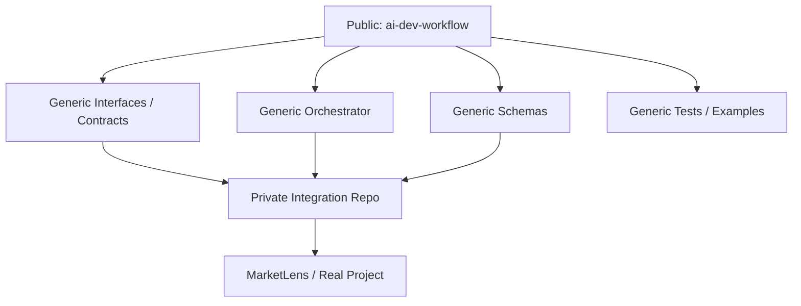

# AI Development Workflow — 由零重新 Setup 指南

> 目標：將以下兩套 workflow 真正落地成一套可以運作嘅 AI Software Development System。
>
> 1. **AI-Powered Idea-to-Ticket Workflow**
> 2. **Multi-Agent Automated Coding Workflow**
>
> 最終流程：
>
> ```text
> Idea
>   ↓
> AI Idea-to-Ticket
>   ↓
> GitHub Issue
>   ↓
> Multi-Agent Coding Workflow
>   ↓
> Pull Request
>   ↓
> Human Review
>   ↓
> Merge
> ```

---

## 1. 最清楚嘅整體 Picture

呢兩套 workflow 唔係兩個獨立 project，而係同一條 development pipeline 嘅前半同後半。

```text
                    HARRY
                      │
                      ▼
                 Raw Idea
          "我想加 Market Regime"
                      │
                      ▼
        ┌────────────────────────┐
        │  ① IDEA-TO-TICKET      │
        │                        │
        │ Understand             │
        │ Classify               │
        │ Duplicate check        │
        │ Priority suggestion    │
        │ Draft ticket           │
        └───────────┬────────────┘
                    │
                    ▼
               Harry Review
                    │
            Approve / Park / Reject
                    │
                    ▼
              GitHub Issue
                    │
              Status = Ready
                    │
════════════════════╪════════════════════
                    │
                    ▼
        ┌────────────────────────┐
        │ ② MULTI-AGENT CODING   │
        │                        │
        │ Planner / Architect    │
        │       ↓                │
        │ Developer              │
        │       ↓                │
        │ Tester                 │
        │       ↓                │
        │ Independent Reviewer   │
        └───────────┬────────────┘
                    │
                    ▼
               Pull Request
                    │
                    ▼
               Harry Review
                    │
                    ▼
                  Merge
```

最重要嘅交接點係：

```text
GitHub Issue
```

**Idea-to-Ticket workflow** 負責 coding 之前嘅工作。

**Multi-Agent Coding workflow** 負責 issue Ready 之後嘅 implementation。

---

# 2. 由零重新 Setup 嘅原則

因為而家準備用一個新 GitHub repository 重新開始，所以唔需要保留舊 setup。

建議：

- 用一個新 repo 專門研究 AI development workflow。
- 暫時唔好將 experimental AI orchestration code 放入 MarketLens。
- MarketLens 將來可以成為第一個真正使用呢套 workflow 嘅 project。
- 每次只完成一個 stage。
- 一個 stage work 同驗證好之後先進下一個 stage。
- 唔好一開始就一次過加入 OpenCode、Ollama、CI、worktree、parallel agents 或其他 advanced automation。
- Claude Code 喺 Stage 1 並非必須，但由 Stage 2 開始可以作為主要 implementation agent。

核心原則：

> **先建立最細可用版本，再逐層增加 automation。**

---

# 3. Repository 建議

建立一個獨立 repo：

```text
ai-dev-workflow
```

建議結構：

```text
ai-dev-workflow/
│
├── idea-to-ticket/
├── orchestrator/
├── prompts/
├── schemas/
├── tests/
├── examples/
├── docs/
│   ├── setup/
│   ├── docs/explanations/
│   └── architecture/
├── .ai/
│
├── AGENTS.md
├── CLAUDE.md
├── README.md
├── .env.example
└── .gitignore
```

概念上：

```text
ai-dev-workflow
       │
       │ manages
       ▼
MarketLens
```

而唔係：

```text
MarketLens
└── 一大堆 experimental AI orchestration
```

## Documentation Layout

Markdown documentation 建議按用途分類：

```text
docs/
├── setup/
├── docs/explanations/
└── architecture/
```

用途：

```text
docs/setup/
= How do I install, configure, or build this?

docs/explanations/
= What is this concept and why does it matter?

docs/architecture/
= How is the system designed?
```

例如：

```text
docs/setup/fresh-setup-guide.md

docs/explanations/what-is-agents-md.md
docs/explanations/what-is-claude-md.md
docs/explanations/what-is-an-orchestrator.md

docs/architecture/idea-to-ticket-workflow.md
docs/architecture/multi-agent-coding-workflow.md
docs/architecture/public-private-repository-boundary.md
```

`README.md` 保持做 project front door，唔需要將所有詳細解釋全部塞入 README。

---

# 3A. Public / Private Repository Arrangement

因為呢個 project 本身有一部分非常適合做 portfolio、教學同 reference implementation，所以建議由一開始就將 **公開 framework** 同 **私人 integration** 分開。

核心概念：

```text
PUBLIC
ai-dev-workflow
│
├── README.md
├── AGENTS.md
├── CLAUDE.md
├── docs/
│   ├── setup/
│   ├── docs/explanations/
│   └── architecture/
├── Mermaid diagrams
├── schemas/
├── tests/
├── examples/
├── orchestrator design
└── Generic workflow code

        │
        │ reusable framework / contracts
        ▼

PRIVATE
project-specific integration repo
│
├── Real API credentials
├── Private repo integrations
├── Production configuration
├── Real test data
├── Internal prompts / context
├── Company-specific adapters
└── Deployment-specific settings
```

## Public Repo

建議主要 repo：

```text
ai-dev-workflow
```

可以直接設成：

```text
PUBLIC
```

只要內容保持 generic、唔包含 secrets 或 private company/project information。

適合公開嘅內容包括：

```text
README.md
AGENTS.md
CLAUDE.md
docs/setup/
docs/explanations/
docs/architecture/
Mermaid diagrams
Generic schemas
Generic automated tests
Generic orchestrator framework
Example workflows
Sample tickets
Sample plans
Sample test reports
Sample reviews
.env.example
```

Public repo 嘅角色係：

> **AI development workflow framework / learning project / portfolio project**

即係任何人 clone 落嚟，都可以理解成套 workflow，而唔需要知道 Harry 私人 project 或 production environment。

---

## Private Repo

當之後要將呢套 workflow 接去真正 project，例如 MarketLens，建議用另一個 private repository。

例如：

```text
marketlens-ai-workflow
```

或者：

```text
ai-dev-workflow-private
```

呢個 repo 可以保持：

```text
PRIVATE
```

適合放：

```text
Real API integration configuration
Private GitHub repository information
Private project adapters
Company-specific integration code
Internal environment configuration
Private test data
Deployment configuration
Real operational prompts / context
```

注意：

```text
API keys
Access tokens
Passwords
Private credentials
```

即使係 private repo，都唔應該直接 commit。

呢啲應該放：

```text
.env
Environment Variables
Secret Manager
GitHub Secrets
```

---

## Public Repo 同 Private Repo 嘅關係

建議架構：



文字版本：

```text
               PUBLIC
        ai-dev-workflow
               │
               │ framework
               ▼
       ┌───────────────┐
       │ Interfaces /  │
       │ Contracts     │
       └───────┬───────┘
               │
               │ private integration
               ▼
             PRIVATE
      marketlens-ai-workflow
               │
               ▼
           MarketLens
```

Public repo 唔需要知道：

```text
MarketLens credentials
Production URLs
Private APIs
Private data
Company-specific information
```

Private integration repo 就可以負責將 generic framework 接去真正 project。

---

## 點解一開始就分開？

如果一開始全部放同一個 repo，之後先拆：

```text
Public framework
+
Private config
+
Real project integration
```

容易出現：

```text
Secrets accidentally committed
Private URLs leaked
Personal paths leaked
Company information leaked
Git history difficult to clean
```

相反，由一開始已經定清楚：

```text
Public repo
= framework + documentation + examples

Private repo
= real integrations + private context
```

會簡單好多。

---

## Public Repo Safety Rules

`CLAUDE.md` 本身可以公開，前提係內容只係 generic repository instructions，唔包含 private paths、credentials、company-only context 或 private repo URLs。

Public repo 入面要避免：

```text
.env
API keys
GitHub tokens
Passwords
Real customer data
Private company code
Private company URLs
Production credentials
Private MarketLens configuration
Personal machine paths
Debug logs containing secrets
```

例如唔好 hard-code：

```text
C:\Users\Harry\...
```

應該使用：

```text
<PROJECT_ROOT>
```

或者 environment configuration。

---

## Tests 同 Examples

Public repo 嘅：

```text
tests/
examples/
```

都應該用 fake / sample data。

例如：

```text
example.com
sample-user
sample-repo
dummy-token
TEST_PROJECT
```

唔好用：

```text
real email address
real customer ID
real access token
real production payload
private repository URL
```

---

## 建議新增 `examples/` Folder

Public repo 可以加入：

```text
examples/
├── sample-idea.md
├── sample-ticket.json
├── sample-plan.md
├── sample-test-report.md
└── sample-review.md
```

用途係畀人一入 repo 就可以睇到：

```text
Idea
↓
Ticket
↓
Plan
↓
Implementation
↓
Test
↓
Review
```

一個完整例子。

---

## 建議 Repository Strategy

由零開始時：

```text
Step 1
Create ai-dev-workflow

Step 2
Set visibility = PUBLIC

Step 3
Only keep generic framework / docs / examples

Step 4
Never commit secrets

Step 5
When real project integration is needed,
create a separate PRIVATE repo
```

---

## Public / Private Decision Rule

可以用呢條簡單規則：

```text
如果陌生人睇到呢個 file
會唔會有 security、privacy、
company 或 production risk？
```

如果答案係：

```text
No
```

可以考慮放 Public。

如果答案係：

```text
Yes
```

放 Private，或者根本唔 commit。

---

## 最終建議

目前 `ai-dev-workflow` 主要內容係：

```text
README
Architecture
Mermaid diagrams
AGENTS.md
CLAUDE.md
Schemas
Tests
Orchestrator design
Example workflow
docs/setup/
docs/explanations/
docs/architecture/
```

所以：

> **可以由一開始就設成 Public。**

真正涉及私人或 production integration 嘅內容，之後放另一個 Private repo。

---


# 4. Stage 1 — 建立 AI Development Workflow Repo

## 目標

只建立乾淨 project foundation。

呢個 stage 暫時唔需要：

```text
OpenCode
Grok API
Ollama
Server
Docker
Database
Multi-Agent Orchestrator
```

Claude Code：

```text
Optional in Stage 1
```

Stage 1 唔需要依賴 Claude Code 先完成 repository foundation，但可以預先建立 `CLAUDE.md`，等之後 Stage 2 開始 implementation 時直接使用。

## 要做嘅事

1. 建立 GitHub repository：

```text
ai-dev-workflow
```

建議 visibility：

```text
PUBLIC
```

Public repo 只放 generic framework、documentation、tests 同 examples。
真正 project-specific / private integrations 將來放另一個 Private repo。

2. Clone 去 local。

3. 建立基本 folder structure：

```text
idea-to-ticket/
orchestrator/
prompts/
schemas/
tests/
examples/
docs/
├── setup/
├── docs/explanations/
└── architecture/
.ai/
```

4. 建立：

```text
README.md
AGENTS.md
CLAUDE.md
.env.example
.gitignore
```

其中：

```text
AGENTS.md
= 所有 AI agents 共用嘅 repository rules

CLAUDE.md
= Claude Code-specific entry point
```

`CLAUDE.md` 唔應該取代 `AGENTS.md`。Claude Code 進入 repo 時，應先讀 `AGENTS.md`、`README.md`，有 task 時再讀 `.ai/task.md`。

5. Commit 第一個 baseline。

## Definition of Done

```text
Repository exists
Git works
Local repo works
Main branch clean
Folder structure exists
Public/private boundary is documented
No secrets or private project data are committed
First commit pushed
```

---

# 5. Stage 2 — Idea-to-Ticket v0

呢個係第一個真正要寫嘅功能。

## 目標

做到：

```text
Raw Idea
   ↓
AI
   ↓
Structured Ticket Draft
```

第一版唔需要 GitHub write access。

## CLI 例子

```bash
python idea.py
```

程式問：

```text
What is your idea?
```

例如輸入：

```text
I want to investigate market breadth for MarketLens.
```

AI 輸出：

```text
Title:
Research Market Regime Detection

Type:
RESEARCH

Priority:
NEXT

Problem:
...

Hypothesis:
...

Ready for Development:
No

Recommended Action:
Create research ticket
```

## 建議 Ticket Types

```text
FEATURE
BUG
RESEARCH
EXPERIMENT
DATA
ARCHITECTURE
REFACTOR
DOCUMENTATION
```

## 建議 Priority

```text
NOW
NEXT
LATER
PARKED
```

AI 可以建議，但唔可以自己決定 roadmap。

## Structured Ticket 建議欄位

```text
title
type
project
priority
labels
problem
hypothesis
related_context
duplicate_of
missing_information
requires_experiment
ready_for_development
recommended_action
acceptance_criteria
```

Example：

```json
{
  "title": "Research Market Regime Detection",
  "type": "research",
  "project": "MarketLens",
  "priority": "next",
  "labels": [
    "research",
    "algorithm",
    "market-regime"
  ],
  "duplicate_of": null,
  "problem": "The scanner does not currently include an overall market regime filter.",
  "hypothesis": "A market regime filter may reduce poor-quality signals during weak markets.",
  "requires_experiment": true,
  "ready_for_development": false,
  "recommended_action": "Create research ticket"
}
```

## Stage 2 Tooling 建議

Stage 2 開始真正有 implementation，所以可以開始使用：

```text
Claude Code ✅ Recommended as Primary Implementation Agent
Cursor      ✅ IDE / Integration / Manual Inspection
ChatGPT     ✅ Architecture / Requirements / Planning support
```

Stage 2 暫時仍然唔需要：

```text
OpenCode ❌
Grok API ❌
Formal Multi-Agent Orchestration ❌
Ollama ❌
Server ❌
Docker ❌
Database ❌
```

Claude Code 喺 Stage 2 嘅角色係幫你實作 **Idea-to-Ticket MVP**。

但要遵守：

```text
Execute Stage 2 only
```

即係唔可以因為見到下一步需要 GitHub integration，就提早實作 Stage 3。

## Definition of Done

```text
Harry can enter a raw idea
AI returns valid structured output
Output validates against schema
Readable ticket draft is generated
No GitHub Issue is created automatically
No production project is modified
```

---

# 6. Stage 3 — GitHub Integration

Stage 2 work 之後，先接 GitHub。

## 目標

做到：

```text
Idea
 ↓
AI Draft
 ↓
Search GitHub Issues
 ↓
Possible Duplicate?
 ↓
Draft
 ↓
Harry Approve
 ↓
Create GitHub Issue
```

可以先用：

```text
GitHub CLI
gh
```

之後需要先考慮 GitHub API。

Claude Code 可以繼續作為 Stage 3 嘅主要 implementation agent。

但 GitHub write action 必須保持 human approval：

```text
Claude Code can implement the mechanism
Harry must approve the action
```

即係 Claude Code 可以寫 duplicate search、approval prompt 同 issue creation code，但唔代表佢有權自行 approve 或建立 issue。

## Duplicate Check

新 idea 入嚟之後：

```text
New Idea
   ↓
Search Existing Issues
   ↓
Related Issue?
   /       \
 Yes       No
  │         │
Update     Create
Existing  New Draft
Recommendation
```

AI 只可以建議：

```text
CREATE_NEW
UPDATE_EXISTING
PARK
NEEDS_REVIEW
```

唔可以自動修改 existing issue。

## Human Approval Gate

真正 create GitHub Issue 之前：

```text
Create GitHub Issue? [y/N]
```

Default：

```text
No
```

只有明確 approve 先可以 create。

## Definition of Done

```text
Existing issues can be searched
Possible duplicates can be suggested
Human approval is required
One approved ticket creates one issue
No approval = no write
No coding workflow starts
```

到呢一步：

> **AI-Powered Idea-to-Ticket Workflow 基本完成**

---

# 7. Stage 4 — 簡化版 Multi-Agent Coding

呢一步先正式開始第二套 workflow。

第一版唔好一次過加入所有 automation。

## 目標

只做到：

```text
task.md
   ↓
Planner
   ↓
Developer
   ↓
Tester
   ↓
Reviewer
```

而且可以由一個 orchestrator 順序 handoff。

## 建議角色

重要係角色，而唔係品牌。

概念：

```text
Planner / Architect
        ↓
Developer
        ↓
Tester / Integration
        ↓
Independent Reviewer
```

目前建議角色分工：

```text
Harry           → Repository Owner / Final Authority
ChatGPT / Codex → Planner / Architect
Claude Code     → Primary Developer / Implementation Agent
Cursor          → Integration / Tester / IDE
Grok            → Independent Reviewer
```

但將來可以替換。

Stage 4 同 Stage 2–3 最大分別係：

```text
Stage 2–3
Claude Code 可以做主要 implementation agent
但仲未係正式 multi-agent pipeline

Stage 4
Planner → Developer → Tester → Reviewer
正式成為 workflow contract
```

品牌可以日後替換，但 roles 同 verification boundaries 應該保留。

亦可以之後實驗：

```text
OpenCode
   ↓
Developer
```

---

# 8. Stage 5 — 將兩套 Workflow 接埋

到呢度先真正變成一條完整 pipeline：

```text
Idea
 ↓
AI Intake
 ↓
GitHub Issue
 ↓
Ready
 ↓
AI Coding Team
 ↓
Pull Request
```

必須保留一個重要 gate：

```text
GitHub Issue
     ↓
   Ready?
   /    \
 No      Yes
 │        │
Stop      ▼
       Coding Team
```

原因：

> 一個新 idea 唔應該因為被記錄咗，就自動變成 code change。

---

# 9. Stage 6 — Advanced Automation

成套 basic pipeline 已經 work 之後先做。

## Feedback Loop

```text
Reviewer FAIL
    ↓
Developer Fix
    ↓
Tester Retest
    ↓
Reviewer Review
```

## 再加入

```text
Structured JSON
Retry limits
Error handling
Logging
Token / cost tracking
Run history
```

## 再之後

```text
Git branches
Git worktrees
Parallel agents
```

## 再之後

```text
GitHub Issue
    ↓
Agent Team
    ↓
Pull Request
```

## 最後先做

```text
CI FAIL
   ↓
AI Fix
   ↓
CI Retest
```

最後先考慮：

```text
Auto Merge
Auto Deploy
Production Changes
```

---

# 10. 你而家已有嘅 Tools

目前基本工具：

```text
ChatGPT ✅
Cursor  ✅
Grok    ✅
GitHub  ✅
```

當 implementation 開始時，建議加入：

```text
Claude Code ✅ Recommended from Stage 2
```

而家仍然唔需要急住加入：

```text
OpenCode    ⏳
Ollama      ⏳
Cloud VM    ⏳
```

目前建議工作分工：

```text
Harry
→ Repository owner / final authority

ChatGPT / Codex
→ Planner / Architect

Claude Code
→ Primary Developer / Implementation Agent

Cursor
→ Integration / Tester / IDE

Grok
→ Independent Reviewer
```

重點仍然係：

> **Architecture 應該依賴角色，而唔係永久綁死某一個 AI vendor。**

---

# 11. Claude Code 幾時先需要？

Claude Code **唔係 Stage 1 嘅必要條件**。

比較合理嘅安排係：

```text
Stage 1
Repository foundation
→ Claude Code optional

Stage 2
Idea-to-Ticket MVP implementation
→ Claude Code recommended as Primary Developer

Stage 3
GitHub integration implementation
→ Claude Code continues as Primary Developer

Stage 4
Multi-Agent Coding Workflow
→ Claude Code formally occupies the Developer role
```

即係話：

```text
Stage 2 開始可以用 Claude Code
≠
Stage 2 已經有完整 multi-agent workflow
```

Stage 2–3，Claude Code 只係主要 implementation agent。

到 Stage 4，先正式出現：

```text
Planner
  ↓
Developer
  ↓
Tester
  ↓
Reviewer
```

同時 repository 應該保留：

```text
AGENTS.md
```

作為所有 agents 共用嘅 vendor-neutral rules。

而：

```text
CLAUDE.md
```

就係 Claude Code-specific entry point。

Claude Code 進入 repo 時，應該先讀：

```text
AGENTS.md
README.md
```

有 workflow task 時再讀：

```text
.ai/task.md
```

---

# 12. OpenCode 幾時先需要？

OpenCode 可以 local run。

但第一步唔需要。

將來可以有：

```text
OpenCode
   ↓
Cloud model
```

或者：

```text
OpenCode
   ↓
Ollama
   ↓
Local model
```

OpenCode 比較適合 Stage 4 之後，用嚟研究：

```text
Planner
Developer
Tester
Reviewer
```

其中某一個 role 可唔可以由 provider-neutral/local agent 做。

---

# 13. Ollama 幾時先需要？

更後期。

因為：

```text
OpenCode local
≠
AI model local
```

真正 fully-local 會係：

```text
OpenCode
   ↓
Ollama
   ↓
Local LLM
```

但 local model 嘅：

```text
RAM
GPU
Tool calling
Coding quality
Context size
```

都要另外處理。

所以建議：

```text
Cloud model first
↓
Workflow works
↓
再加入 Local Model
```

---

# 14. 最簡單 Roadmap

```text
┌──────────────────────────────┐
│ Stage 1                      │
│ 建 ai-dev-workflow repo      │
└──────────────┬───────────────┘
               ↓
┌──────────────────────────────┐
│ Stage 2                      │
│ Raw Idea → Structured Ticket │
│ Claude Code can implement    │
│ 暫時 local                   │
└──────────────┬───────────────┘
               ↓
┌──────────────────────────────┐
│ Stage 3                      │
│ GitHub Issue integration     │
│ Duplicate check + approval   │
└──────────────┬───────────────┘
               ↓
      IDEA-TO-TICKET DONE ✅
               ↓
┌──────────────────────────────┐
│ Stage 4                      │
│ Formal multi-agent workflow  │
│ Planner → Developer          │
│ → Tester → Reviewer          │
└──────────────┬───────────────┘
               ↓
┌──────────────────────────────┐
│ Stage 5                      │
│ GitHub Issue → Agent Team    │
│ → Pull Request               │
└──────────────┬───────────────┘
               ↓
      FULL PIPELINE DONE ✅
               ↓
┌──────────────────────────────┐
│ Stage 6                      │
│ Retry / CI / worktree /      │
│ cost / parallel / automation │
└──────────────────────────────┘
```

---

# 15. 今日應該做嘅只有一件事

今日只做：

> **Stage 1 — 建立一個全新 `ai-dev-workflow` repository 同基本 project structure。**

今日 Stage 1 唔需要一次過做：

```text
Configure Claude Code as an active implementation workflow
Install OpenCode
Install Ollama
Build orchestrator
Build GitHub automation
Modify MarketLens
```

可以先準備 `CLAUDE.md`，但真正用 Claude Code 寫 Stage 2 code 可以等 Stage 1 baseline 完成之後先開始。

第一張真正畀呢套 workflow 處理嘅 ticket，可以就係：

```text
Build the Idea-to-Ticket MVP
```

概念：

```text
你先人手建立第一張 ticket
           ↓
Build Idea-to-Ticket
           ↓
之後所有 ticket
可以由 Idea-to-Ticket 幫你產生
           ↓
再由 Multi-Agent Pipeline 寫 code
```

---

# 16. 最終成功 Picture

最後你想做到：

```text
Harry
  ↓
Idea
  ↓
AI Intake
  ↓
Structured Ticket
  ↓
Human Approval
  ↓
GitHub Issue
  ↓
Ready
  ↓
Planner
  ↓
Developer
  ↓
Tester
  ↓
Independent Reviewer
  ↓
Pull Request
  ↓
Harry Review
  ↓
Merge
```

最重要嘅 design principle：

> **Capturing an idea must not automatically turn that idea into code.**

第二個 principle：

> **每次只完成一個 stage，驗證成功先進下一個 stage。**

第三個 principle：

> **角色比工具品牌更重要。**

第四個 principle：

> **No AI agent is the repository owner. Human authority remains final.**

目前角色定位：

```text
Harry           → Owner / Final Authority
ChatGPT / Codex → Planner / Architect
Claude Code     → Primary Developer
Cursor          → Integration / Tester / IDE
Grok            → Independent Reviewer
```

今日真正要開始嘅地方：

```text
Stage 1
建立 ai-dev-workflow repo
```
