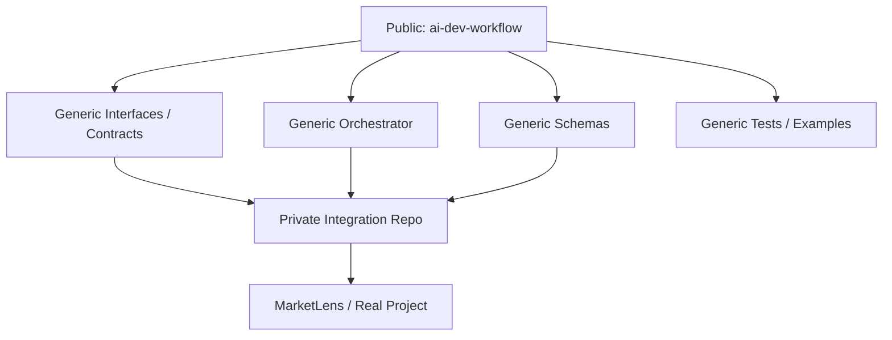

# AI Development Workflow — 由零重新 Setup 指南 (v5)

> **v5 update:** Stage 1 已完成；Stage 2 更新為 2A Local Core、2B Live AI Integration、2C Large Input Decomposition，並加入 `idea_to_ticket` Python package 命名同 architecture reference。

> 目標：將以下兩套 workflow 真正落地成一套可以運作嘅 AI Software Development System。
>
> 1. **AI-Powered Idea-to-Ticket Workflow**
> 2. **Multi-Agent Automated Coding Workflow**
>
> 最終流程：
>
> ```text
> Idea
>   ↓
> AI Idea-to-Ticket
>   ↓
> GitHub Issue
>   ↓
> Multi-Agent Coding Workflow
>   ↓
> Pull Request
>   ↓
> Human Review
>   ↓
> Merge
> ```

---

## 1. 最清楚嘅整體 Picture

而家成套 system 唔再假設所有 input 都只係一句細 idea。

Input 可以係：

```text
Small Idea
Feature Request
Bug Description
Research Question
Large Product Design
Requirements Document
Architecture Document
Technical Specification
```

AI Intake 首先理解 input，然後判斷應該：

```text
Small / Focused Input
        ↓
Single Ticket Draft
```

定係：

```text
Large / Complex Input
        ↓
Hierarchical Work Breakdown
        ↓
Epic
├── Story
│   ├── Task
│   └── Task
├── Research
└── Architecture / Data / Documentation / Other Work
```

完整方向：

```text
                    HARRY
                      │
                      ▼
          Idea / Design / Specification
                      │
                      ▼
            ┌──────────────────────┐
            │ ① AI IDEA INTAKE     │
            │                      │
            │ Understand           │
            │ Classify             │
            │ Determine scope      │
            │ Suggest priority     │
            │ Identify gaps        │
            └──────────┬───────────┘
                       │
             ┌─────────┴─────────┐
             │                   │
             ▼                   ▼
       Small / Focused       Large / Complex
             │                   │
             ▼                   ▼
       Single Ticket       Work Breakdown
                               │
                         Epic / Story /
                         Task / Research /
                         Other work items
             │                   │
             └─────────┬─────────┘
                       ▼
                 Harry Review
                       │
              Approve / Edit /
               Park / Reject
                       │
                       ▼
              ② GITHUB INTEGRATION
                       │
               Duplicate Check
                       │
                 Human Approval
                       │
                       ▼
                 GitHub Issue(s)
                       │
                   Ready Gate
                       │
                       ▼
            ③ MULTI-AGENT CODING
                       │
              Planner / Architect
                       ↓
                   Developer
                       ↓
                    Tester
                       ↓
             Independent Reviewer
                       │
                       ▼
                 Pull Request
                       │
                       ▼
                  Harry Review
                       │
                       ▼
                     Merge
```

最重要嘅交接點仍然係：

```text
Approved GitHub work
        ↓
Ready
        ↓
Coding Workflow
```

但要加多一條重要規則：

```text
AI decomposition
≠ approval
≠ Ready status
≠ permission to start coding
```

**Idea-to-Ticket workflow** 負責 coding 之前嘅 understanding、ticket drafting 同 work breakdown。

**GitHub Integration** 負責 duplicate search、human approval 同真正 GitHub write。

**Multi-Agent Coding workflow** 只可以處理已經由 human 明確批准並標記為 `Ready` 嘅 work item。

詳細 Idea-to-Ticket architecture 應該放喺：

```text
docs/architecture/idea-to-ticket-workflow.md
```

---

# 2. 由零重新 Setup 嘅原則

因為而家準備用一個新 GitHub repository 重新開始，所以唔需要保留舊 setup。

建議：

- 用一個新 repo 專門研究 AI development workflow。
- 暫時唔好將 experimental AI orchestration code 放入 MarketLens。
- MarketLens 將來可以成為第一個真正使用呢套 workflow 嘅 project。
- 每次只完成一個 stage。
- 一個 stage work 同驗證好之後先進下一個 stage。
- 唔好一開始就一次過加入 OpenCode、Ollama、CI、worktree、parallel agents 或其他 advanced automation。
- Claude Code 喺 Stage 1 並非必須，但由 Stage 2 開始可以作為主要 implementation agent。

核心原則：

> **先建立最細可用版本，再逐層增加 automation。**

---

# 3. Repository 建議

建立一個獨立 repo：

```text
ai-dev-workflow
```

建議結構：

```text
ai-dev-workflow/
│
├── idea_to_ticket/
├── orchestrator/
├── prompts/
├── schemas/
├── tests/
├── examples/
├── docs/
│   ├── setup/
│   ├── explanations/
│   └── architecture/
├── .ai/
│
├── AGENTS.md
├── CLAUDE.md
├── README.md
├── .env.example
└── .gitignore
```

概念上：

```text
ai-dev-workflow
       │
       │ manages
       ▼
MarketLens
```

而唔係：

```text
MarketLens
└── 一大堆 experimental AI orchestration
```

## Documentation Layout

Markdown documentation 建議按用途分類：

```text
docs/
├── setup/
├── explanations/
└── architecture/
```

用途：

```text
docs/setup/
= How do I install, configure, or build this?

docs/explanations/
= What is this concept and why does it matter?

docs/architecture/
= How is the system designed?
```

例如：

```text
docs/setup/fresh-setup-guide.md

docs/explanations/what-is-agents-md.md
docs/explanations/what-is-claude-md.md
docs/explanations/what-is-an-orchestrator.md

docs/architecture/idea-to-ticket-workflow.md
docs/architecture/multi-agent-coding-workflow.md
docs/architecture/public-private-repository-boundary.md
```

`README.md` 保持做 project front door，唔需要將所有詳細解釋全部塞入 README。

---

# 3A. Public / Private Repository Arrangement

因為呢個 project 本身有一部分非常適合做 portfolio、教學同 reference implementation，所以建議由一開始就將 **公開 framework** 同 **私人 integration** 分開。

核心概念：

```text
PUBLIC
ai-dev-workflow
│
├── README.md
├── AGENTS.md
├── CLAUDE.md
├── docs/
│   ├── setup/
│   ├── explanations/
│   └── architecture/
├── Mermaid diagrams
├── schemas/
├── tests/
├── examples/
├── orchestrator design
└── Generic workflow code

        │
        │ reusable framework / contracts
        ▼

PRIVATE
project-specific integration repo
│
├── Real API credentials
├── Private repo integrations
├── Production configuration
├── Real test data
├── Internal prompts / context
├── Company-specific adapters
└── Deployment-specific settings
```

## Public Repo

建議主要 repo：

```text
ai-dev-workflow
```

可以直接設成：

```text
PUBLIC
```

只要內容保持 generic、唔包含 secrets 或 private company/project information。

適合公開嘅內容包括：

```text
README.md
AGENTS.md
CLAUDE.md
docs/setup/
docs/explanations/
docs/architecture/
Mermaid diagrams
Generic schemas
Generic automated tests
Generic orchestrator framework
Example workflows
Sample tickets
Sample plans
Sample test reports
Sample reviews
.env.example
```

Public repo 嘅角色係：

> **AI development workflow framework / learning project / portfolio project**

即係任何人 clone 落嚟，都可以理解成套 workflow，而唔需要知道 Harry 私人 project 或 production environment。

---

## Private Repo

當之後要將呢套 workflow 接去真正 project，例如 MarketLens，建議用另一個 private repository。

例如：

```text
marketlens-ai-workflow
```

或者：

```text
ai-dev-workflow-private
```

呢個 repo 可以保持：

```text
PRIVATE
```

適合放：

```text
Real API integration configuration
Private GitHub repository information
Private project adapters
Company-specific integration code
Internal environment configuration
Private test data
Deployment configuration
Real operational prompts / context
```

注意：

```text
API keys
Access tokens
Passwords
Private credentials
```

即使係 private repo，都唔應該直接 commit。

呢啲應該放：

```text
.env
Environment Variables
Secret Manager
GitHub Secrets
```

---

## Public Repo 同 Private Repo 嘅關係

建議架構：



文字版本：

```text
               PUBLIC
        ai-dev-workflow
               │
               │ framework
               ▼
       ┌───────────────┐
       │ Interfaces /  │
       │ Contracts     │
       └───────┬───────┘
               │
               │ private integration
               ▼
             PRIVATE
      marketlens-ai-workflow
               │
               ▼
           MarketLens
```

Public repo 唔需要知道：

```text
MarketLens credentials
Production URLs
Private APIs
Private data
Company-specific information
```

Private integration repo 就可以負責將 generic framework 接去真正 project。

---

## 點解一開始就分開？

如果一開始全部放同一個 repo，之後先拆：

```text
Public framework
+
Private config
+
Real project integration
```

容易出現：

```text
Secrets accidentally committed
Private URLs leaked
Personal paths leaked
Company information leaked
Git history difficult to clean
```

相反，由一開始已經定清楚：

```text
Public repo
= framework + documentation + examples

Private repo
= real integrations + private context
```

會簡單好多。

---

## Public Repo Safety Rules

`CLAUDE.md` 本身可以公開，前提係內容只係 generic repository instructions，唔包含 private paths、credentials、company-only context 或 private repo URLs。

Public repo 入面要避免：

```text
.env
API keys
GitHub tokens
Passwords
Real customer data
Private company code
Private company URLs
Production credentials
Private MarketLens configuration
Personal machine paths
Debug logs containing secrets
```

例如唔好 hard-code：

```text
C:\Users\Harry\...
```

應該使用：

```text
<PROJECT_ROOT>
```

或者 environment configuration。

---

## Tests 同 Examples

Public repo 嘅：

```text
tests/
examples/
```

都應該用 fake / sample data。

例如：

```text
example.com
sample-user
sample-repo
dummy-token
TEST_PROJECT
```

唔好用：

```text
real email address
real customer ID
real access token
real production payload
private repository URL
```

---

## 建議新增 `examples/` Folder

Public repo 可以加入：

```text
examples/
├── sample-idea.md
├── sample-ticket.json
├── sample-plan.md
├── sample-test-report.md
└── sample-review.md
```

用途係畀人一入 repo 就可以睇到：

```text
Idea
↓
Ticket
↓
Plan
↓
Implementation
↓
Test
↓
Review
```

一個完整例子。

---

## 建議 Repository Strategy

由零開始時：

```text
Step 1
Create ai-dev-workflow

Step 2
Set visibility = PUBLIC

Step 3
Only keep generic framework / docs / examples

Step 4
Never commit secrets

Step 5
When real project integration is needed,
create a separate PRIVATE repo
```

---

## Public / Private Decision Rule

可以用呢條簡單規則：

```text
如果陌生人睇到呢個 file
會唔會有 security、privacy、
company 或 production risk？
```

如果答案係：

```text
No
```

可以考慮放 Public。

如果答案係：

```text
Yes
```

放 Private，或者根本唔 commit。

---

## 最終建議

目前 `ai-dev-workflow` 主要內容係：

```text
README
Architecture
Mermaid diagrams
AGENTS.md
CLAUDE.md
Schemas
Tests
Orchestrator design
Example workflow
docs/setup/
docs/explanations/
docs/architecture/
```

所以：

> **可以由一開始就設成 Public。**

真正涉及私人或 production integration 嘅內容，之後放另一個 Private repo。

---


# 4. Stage 1 — 建立 AI Development Workflow Repo

## 目標

只建立乾淨 project foundation。

呢個 stage 暫時唔需要：

```text
OpenCode
Grok API
Ollama
Server
Docker
Database
Multi-Agent Orchestrator
```

Claude Code：

```text
Optional in Stage 1
```

Stage 1 唔需要依賴 Claude Code 先完成 repository foundation，但可以預先建立 `CLAUDE.md`，等之後 Stage 2 開始 implementation 時直接使用。

## 要做嘅事

1. 建立 GitHub repository：

```text
ai-dev-workflow
```

建議 visibility：

```text
PUBLIC
```

Public repo 只放 generic framework、documentation、tests 同 examples。
真正 project-specific / private integrations 將來放另一個 Private repo。

2. Clone 去 local。

3. 建立基本 folder structure：

```text
idea_to_ticket/
orchestrator/
prompts/
schemas/
tests/
examples/
docs/
├── setup/
├── explanations/
└── architecture/
.ai/
```

4. 建立：

```text
README.md
AGENTS.md
CLAUDE.md
.env.example
.gitignore
```

其中：

```text
AGENTS.md
= 所有 AI agents 共用嘅 repository rules

CLAUDE.md
= Claude Code-specific entry point
```

`CLAUDE.md` 唔應該取代 `AGENTS.md`。Claude Code 進入 repo 時，應先讀 `AGENTS.md`、`README.md`，有 task 時再讀 `.ai/task.md`。

5. Commit 第一個 baseline。

## Definition of Done

```text
Repository exists
Git works
Local repo works
Main branch clean
Folder structure exists
Public/private boundary is documented
No secrets or private project data are committed
First commit pushed
```

---

# 5. Stage 2 — Idea-to-Ticket MVP

Stage 2 係第一個真正要寫嘅功能。

但 Stage 2 而家要分清楚三個 sub-phases：

```text
Stage 2A — Local Core
Stage 2B — Live AI Integration
Stage 2C — Large Input Decomposition
```

其中：

- **Stage 2A + Stage 2B** = immediate single-ticket MVP
- **Stage 2C** = planned extension for large designs / specifications
- Stage 2C 暫時唔需要同 2A 一次過實作

詳細 implementation plan 應該放：

```text
docs/setup/stage-2-idea-to-ticket-mvp-implementation-plan.md
```

詳細 architecture 應該放：

```text
docs/architecture/idea-to-ticket-workflow.md
```

---

## Stage 2A — Local Core

### 目標

先建立一部可靠嘅「ticket machine」，暫時唔 call 真 AI。

做到：

```text
Known / Fake Structured Ticket
        ↓
Schema Validation
        ↓
Readable Ticket
```

Stage 2A 建議包括：

```text
idea_to_ticket/
├── __init__.py
├── idea.py
├── pipeline.py
├── provider.py
└── render.py

prompts/
└── idea_intake.md

schemas/
├── __init__.py
└── ticket.py

examples/
├── sample-idea.md
└── sample-ticket.json

tests/
├── test_ticket_schema.py
├── test_render.py
└── test_pipeline.py

pyproject.toml
```

### 點解先用 FakeDrafter？

Stage 2A 應該可以完全唔用：

```text
API key
Internet
Paid AI call
```

`FakeDrafter` 會畀固定 AI-like response，等我哋可以先驗證：

```text
Schema ✅
Validation ✅
Pipeline ✅
Renderer ✅
CLI ✅
Tests ✅
```

而唔需要將 AI API、network 同 core logic 一次過混埋一齊。

### CLI

正式 package 名：

```text
idea_to_ticket
```

Human-facing workflow 名：

```text
Idea-to-Ticket
```

Primary CLI：

```bash
python -m idea_to_ticket.idea
```

Stage 2A fixture test：

```bash
python -m idea_to_ticket.idea --fixture examples/sample-ticket.json
```

Stage 2A 完成時：

```text
pytest passes
fixture CLI works
valid ticket passes schema
invalid ticket is rejected
readable output is generated
```

但：

> **Stage 2A 完成 ≠ Stage 2 MVP 完成**

因為仲未有真 AI。

---

## Stage 2B — Live AI Integration

### 目標

接一個真正 AI provider，做到：

```text
Harry
  ↓
Raw Idea
  ↓
Real AI
  ↓
Structured Ticket JSON
  ↓
Schema Validation
  ↓
Readable Ticket
```

只實作：

```text
ONE approved AI provider
```

唔好一開始加：

```text
OpenAI + Anthropic + xAI + Ollama
```

Provider / model 由 Harry 喺 Stage 2B 開始前決定。

Architecture 應該保持 provider-neutral：

```text
Idea-to-Ticket
      ↓
Provider Interface
      ↓
One Approved AI Provider
```

### Live CLI Example

```bash
python -m idea_to_ticket.idea
```

程式問：

```text
What is your idea?
```

例如：

```text
I want the workflow to detect duplicate ideas before new work is started.
```

AI 可以輸出 structured ticket：

```json
{
  "title": "Add duplicate idea detection",
  "type": "feature",
  "project": "AI Development Workflow",
  "priority": "next",
  "labels": ["idea-to-ticket"],
  "problem": "New ideas may duplicate existing work.",
  "hypothesis": "Checking existing work before development may reduce duplicated effort.",
  "related_context": "",
  "duplicate_of": null,
  "missing_information": [],
  "requires_experiment": false,
  "ready_for_development": false,
  "recommended_action": "Review duplicate detection design before implementation.",
  "acceptance_criteria": [
    "The system can represent a valid structured ticket.",
    "AI recommendations do not automatically start implementation."
  ]
}
```

跟住：

```text
AI output
   ↓
Pydantic validation
   ↓
Readable ticket
```

### 建議 Ticket Types

```text
FEATURE
BUG
RESEARCH
EXPERIMENT
DATA
ARCHITECTURE
REFACTOR
DOCUMENTATION
```

### 建議 Priority

```text
NOW
NEXT
LATER
PARKED
```

AI 可以建議，但唔可以自己決定 roadmap。

### Structured Ticket 建議欄位

```text
title
type
project
priority
labels
problem
hypothesis
related_context
duplicate_of
missing_information
requires_experiment
ready_for_development
recommended_action
acceptance_criteria
```

Stage 2A–2B：

```text
duplicate_of = null
```

因為真正 GitHub duplicate checking 係 Stage 3。

### Stage 2B Definition of Done

```text
Harry can enter a real raw idea
Real AI returns structured output
Output validates against TicketDraft schema
Readable ticket draft is generated
pytest still passes without network
No GitHub Issue is created automatically
No GitHub Project is modified
No production project is modified
```

做到呢度：

> **Single-ticket Stage 2 MVP COMPLETE ✅**

---

## Stage 2C — Large Input Decomposition

Stage 2C 係下一個 planned extension。

佢用嚟處理：

```text
Large Product Design
Requirements Document
Architecture Document
Technical Specification
Project Proposal
```

例如完整 MarketLens design。

### 目標

```text
Large Design / Specification
        ↓
AI Analysis
        ↓
Determine Scope
        ↓
Hierarchical Work Breakdown
        ↓
Epic
├── Story
│   ├── Task
│   └── Task
├── Research
└── Architecture / Data / Documentation / Other
        ↓
Schema Validation
        ↓
Source Traceability
        ↓
Human-Readable Proposed Breakdown
        ↓
Harry Review
```

### Epic / Story / Task

簡單定義：

```text
Epic
= 大 capability / major outcome

Story
= 有清楚 outcome 嘅功能

Task
= 可以實際執行嘅 implementation work
```

但唔係所有 work 都要強迫變成 Task。

亦可以有：

```text
RESEARCH
EXPERIMENT
ARCHITECTURE
DATA
BUG
REFACTOR
DOCUMENTATION
```

### Parent / Child Relationship

Work breakdown 應該保留明確 hierarchy：

```text
Epic
 └── Story
      ├── Task
      ├── Task
      └── Research
```

未來 schema 可以考慮：

```text
id
parent_id
work_item_level
type
title
children
dependencies
```

但 Stage 2C schema 要喺 implementation 前另外 review / approve。

### Source Traceability

Large input decomposition 必須記住 work item 由原 source 邊度嚟。

例如：

```json
{
  "title": "Implement VCP detector",
  "parent_id": "story-vcp-detection",
  "source_context": [
    "MarketLens Design > Stock Screening > VCP Detection",
    "MarketLens Design > Detection Rules"
  ]
}
```

目的係可以回答：

```text
Why did AI create this work item?
```

而唔係由 AI 無根據 invent requirement。

### Small vs Large Input

AI 應該判斷：

```text
Is this focused enough to be one ticket?
        │
        ├── Yes
        │    ↓
        │ Single Ticket
        │
        └── No
             ↓
          Decompose
             ↓
        Proposed Work Breakdown
```

重點係：

> **Small idea 唔應該被 over-decompose。**

### Stage 2C 必須保留 Human Gate

```text
AI decomposition
≠ approval
≠ Ready
≠ coding authorization
```

Harry 可以：

```text
Approve
Edit
Merge items
Split items
Change hierarchy
Change priority
Park
Reject
Request more analysis
```

### Stage 2C 暫時唔做

Immediate implementation 先做：

```text
Stage 2A
↓
Stage 2B
```

Stage 2C 要先另外設計：

```text
WorkBreakdown schema
Hierarchy rules
Traceability fields
Scope detection
Large-document strategy
Hierarchy renderer
Tests
```

先至開始 implementation。

---

## Stage 2 Tooling 建議

Stage 2 implementation 可以使用：

```text
Cursor      ✅ Implementation / IDE / Testing
Claude Code ✅ Optional implementation agent
ChatGPT     ✅ Architecture / Requirements / Planning
```

Architecture 唔應該依賴某一個 AI coding tool。

Stage 2 暫時唔需要：

```text
OpenCode ❌
Formal Multi-Agent Orchestration ❌
Ollama ❌
Server ❌
Docker ❌
Database ❌
GitHub write automation ❌
```

無論用 Cursor 定 Claude Code，都要遵守：

```text
Execute current approved phase only
```

即係：

```text
Stage 2A 唔偷跑去 2B
Stage 2B 唔偷跑去 2C
Stage 2 唔偷跑去 Stage 3
```

---

## Stage 2 Architecture Rules

Stage 2 必須保留：

```text
AI may recommend
Human decides
```

同：

```text
Capturing an idea
≠ creating GitHub work
≠ marking Ready
≠ starting code
```

詳細規則以：

```text
docs/architecture/idea-to-ticket-workflow.md
```

為 architecture source of truth。

---

# 6. Stage 3 — GitHub Integration

Stage 2 work 之後，先接 GitHub。

## 目標

做到：

```text
Approved Ticket / Work Breakdown Draft
 ↓
Search GitHub Issues
 ↓
Possible Duplicate?
 ↓
Draft
 ↓
Harry Approve
 ↓
Create GitHub Issue
```

可以先用：

```text
GitHub CLI
gh
```

之後需要先考慮 GitHub API。

Claude Code 可以繼續作為 Stage 3 嘅主要 implementation agent。

但 GitHub write action 必須保持 human approval：

```text
Claude Code can implement the mechanism
Harry must approve the action
```

即係 Claude Code 可以寫 duplicate search、approval prompt 同 issue creation code，但唔代表佢有權自行 approve 或建立 issue。

## Duplicate Check

新 idea 入嚟之後：

```text
New Idea
   ↓
Search Existing Issues
   ↓
Related Issue?
   /       \
 Yes       No
  │         │
Update     Create
Existing  New Draft
Recommendation
```

AI 只可以建議：

```text
CREATE_NEW
UPDATE_EXISTING
PARK
NEEDS_REVIEW
```

唔可以自動修改 existing issue。

## Human Approval Gate

真正 create GitHub Issue 之前：

```text
Create GitHub Issue? [y/N]
```

Default：

```text
No
```

只有明確 approve 先可以 create。

## Definition of Done

```text
Existing issues can be searched
Possible duplicates can be suggested
Human approval is required
One approved single ticket can create one issue
Approved decomposed work may later create linked issues/sub-issues after hierarchy support is implemented
No approval = no write
No coding workflow starts
```

到呢一步：

> **AI-Powered Idea-to-Ticket Workflow 基本完成**

---

# 7. Stage 4 — 簡化版 Multi-Agent Coding

呢一步先正式開始第二套 workflow。

第一版唔好一次過加入所有 automation。

## 目標

只做到：

```text
task.md
   ↓
Planner
   ↓
Developer
   ↓
Tester
   ↓
Reviewer
```

而且可以由一個 orchestrator 順序 handoff。

## 建議角色

重要係角色，而唔係品牌。

概念：

```text
Planner / Architect
        ↓
Developer
        ↓
Tester / Integration
        ↓
Independent Reviewer
```

目前建議角色分工：

```text
Harry           → Repository Owner / Final Authority
ChatGPT / Codex → Planner / Architect
Claude Code     → Primary Developer / Implementation Agent
Cursor          → Integration / Tester / IDE
Grok            → Independent Reviewer
```

但將來可以替換。

Stage 4 同 Stage 2–3 最大分別係：

```text
Stage 2–3
Claude Code 可以做主要 implementation agent
但仲未係正式 multi-agent pipeline

Stage 4
Planner → Developer → Tester → Reviewer
正式成為 workflow contract
```

品牌可以日後替換，但 roles 同 verification boundaries 應該保留。

亦可以之後實驗：

```text
OpenCode
   ↓
Developer
```

---

# 8. Stage 5 — 將兩套 Workflow 接埋

到呢度先真正變成一條完整 pipeline：

```text
Idea
 ↓
AI Intake
 ↓
GitHub Issue
 ↓
Ready
 ↓
AI Coding Team
 ↓
Pull Request
```

必須保留一個重要 gate：

```text
GitHub Issue
     ↓
   Ready?
   /    \
 No      Yes
 │        │
Stop      ▼
       Coding Team
```

原因：

> 一個新 idea 唔應該因為被記錄咗，就自動變成 code change。

---

# 9. Stage 6 — Advanced Automation

成套 basic pipeline 已經 work 之後先做。

## Feedback Loop

```text
Reviewer FAIL
    ↓
Developer Fix
    ↓
Tester Retest
    ↓
Reviewer Review
```

## 再加入

```text
Structured JSON
Retry limits
Error handling
Logging
Token / cost tracking
Run history
```

## 再之後

```text
Git branches
Git worktrees
Parallel agents
```

## 再之後

```text
GitHub Issue
    ↓
Agent Team
    ↓
Pull Request
```

## 最後先做

```text
CI FAIL
   ↓
AI Fix
   ↓
CI Retest
```

最後先考慮：

```text
Auto Merge
Auto Deploy
Production Changes
```

---

# 10. 你而家已有嘅 Tools

目前基本工具：

```text
ChatGPT ✅
Cursor  ✅
Grok    ✅
GitHub  ✅
```

當 implementation 開始時，建議加入：

```text
Claude Code ✅ Recommended from Stage 2
```

而家仍然唔需要急住加入：

```text
OpenCode    ⏳
Ollama      ⏳
Cloud VM    ⏳
```

目前建議工作分工：

```text
Harry
→ Repository owner / final authority

ChatGPT / Codex
→ Planner / Architect

Cursor
→ Current implementation / IDE / testing tool

Claude Code
→ Optional implementation agent

Grok
→ Independent Reviewer (formal role later)
```

重點仍然係：

> **Architecture 應該依賴角色，而唔係永久綁死某一個 AI vendor。**

---

# 11. Claude Code 幾時先需要？

Claude Code **唔係 Stage 1 或 Stage 2 嘅必要條件**。

而家可以直接用：

```text
Cursor
```

實作 Stage 2A / Stage 2B。

Claude Code 仍然可以作為：

```text
Optional implementation agent
```

如果之後想比較唔同 coding agents，或者 Stage 4 正式建立 multi-agent workflow，可以再加入 Claude Code。

比較合理嘅理解：

```text
Stage 1
Repository foundation
→ Claude Code not required

Stage 2
Idea-to-Ticket implementation
→ Cursor can implement
→ Claude Code optional

Stage 3
GitHub integration
→ implementation agent can still be Cursor / Claude / other approved tool

Stage 4
Formal Multi-Agent Coding Workflow
→ Developer becomes a formal role
→ specific vendor can be chosen or swapped
```

重點：

```text
Developer = role
Claude Code = one possible tool
Cursor = one possible tool
```

Architecture 唔應該永久綁死某一個 AI vendor。

Repository 仍然保留：

```text
AGENTS.md
```

作為所有 agents 共用嘅 vendor-neutral rules。

而：

```text
CLAUDE.md
```

只係 Claude Code-specific entry point。

如果 Claude Code 將來進入 repo，應該先讀：

```text
AGENTS.md
README.md
```

有 workflow task 時再讀：

```text
.ai/task.md
```

---

# 12. OpenCode 幾時先需要？

OpenCode 可以 local run。

但第一步唔需要。

將來可以有：

```text
OpenCode
   ↓
Cloud model
```

或者：

```text
OpenCode
   ↓
Ollama
   ↓
Local model
```

OpenCode 比較適合 Stage 4 之後，用嚟研究：

```text
Planner
Developer
Tester
Reviewer
```

其中某一個 role 可唔可以由 provider-neutral/local agent 做。

---

# 13. Ollama 幾時先需要？

更後期。

因為：

```text
OpenCode local
≠
AI model local
```

真正 fully-local 會係：

```text
OpenCode
   ↓
Ollama
   ↓
Local LLM
```

但 local model 嘅：

```text
RAM
GPU
Tool calling
Coding quality
Context size
```

都要另外處理。

所以建議：

```text
Cloud model first
↓
Workflow works
↓
再加入 Local Model
```

---

# 14. 最簡單 Roadmap

```text
┌────────────────────────────────┐
│ Stage 1                        │
│ Repository Foundation          │
│ COMPLETE ✅                    │
└───────────────┬────────────────┘
                ↓
┌────────────────────────────────┐
│ Stage 2A                       │
│ Local Ticket Core              │
│ Schema / Validation / Tests    │
└───────────────┬────────────────┘
                ↓
┌────────────────────────────────┐
│ Stage 2B                       │
│ Single Idea → Real AI          │
│ → Validated Single Ticket      │
└───────────────┬────────────────┘
                ↓
      SINGLE-TICKET MVP ✅
                ↓
┌────────────────────────────────┐
│ Stage 2C                       │
│ Large Design → Work Breakdown  │
│ Epic / Story / Task / Research │
│ + Source Traceability          │
└───────────────┬────────────────┘
                ↓
┌────────────────────────────────┐
│ Stage 3                        │
│ GitHub Integration             │
│ Duplicate Check + Approval     │
│ Create / Update Issues         │
└───────────────┬────────────────┘
                ↓
      IDEA-TO-TICKET DONE ✅
                ↓
┌────────────────────────────────┐
│ Stage 4                        │
│ Formal Multi-Agent Workflow    │
│ Planner → Developer            │
│ → Tester → Reviewer            │
└───────────────┬────────────────┘
                ↓
┌────────────────────────────────┐
│ Stage 5                        │
│ GitHub Ready Work              │
│ → Agent Team → Pull Request    │
└───────────────┬────────────────┘
                ↓
        FULL PIPELINE ✅
                ↓
┌────────────────────────────────┐
│ Stage 6                        │
│ Retry / CI / worktree /        │
│ cost / parallel / automation   │
└────────────────────────────────┘
```

如果想先快啲完成 single-ticket flow，Stage 2B 完成後亦可以先做 single-ticket Stage 3 integration，再返嚟做 Stage 2C。

但如果目標係將完整 MarketLens design 一次過拆成 hierarchy，再寫入 GitHub，就應該先完成 Stage 2C 嘅 schema / decomposition design。

---

# 15. 而家應該做嘅下一步

Stage 1 已經完成。

而家唔需要再做 repository foundation。

下一步係：

> **Stage 2A — Local Core**

即係先實作：

```text
Ticket Schema
Validation
Renderer
Pipeline
FakeDrafter
CLI
Tests
```

暫時唔需要：

```text
OpenAI / Anthropic API
GitHub write automation
Stage 2C decomposition
Multi-Agent Orchestrator
OpenCode
Ollama
Docker
Production integration
```

第一張 GitHub Issue 已經可以係：

```text
Build the Idea-to-Ticket MVP
```

Stage 2A 完成之後先 review：

```text
pytest
fixture CLI
schema behaviour
render output
```

確認 work 先進 Stage 2B。

Stage 2B 再由 Harry 決定一個 AI provider / model。

Stage 2C large-input decomposition 暫時先保留喺 architecture 同 implementation plan，唔需要而家一次過寫晒。

---

# 16. 最終成功 Picture

最後想做到：

```text
Harry
  ↓
Small Idea
OR
Large Design / Requirements / Specification
  ↓
AI Intake
  ↓
Understand / Classify / Determine Scope
  ↓
┌─────────────────────────────┐
│ Small Input                 │
│   ↓                         │
│ Single Ticket Draft         │
│                             │
│ Large Input                 │
│   ↓                         │
│ Hierarchical Work Breakdown │
│   ↓                         │
│ Epic / Story / Task /       │
│ Research / Other Work       │
└─────────────────────────────┘
  ↓
Schema Validation
  ↓
Source Traceability
  ↓
Human Review
  ↓
Approve / Edit / Park / Reject
  ↓
GitHub Duplicate Check
  ↓
Human Approval for Write
  ↓
GitHub Issue(s)
  ↓
Ready Gate
  ↓
Planner / Architect
  ↓
Developer
  ↓
Tester
  ↓
Independent Reviewer
  ↓
Pull Request
  ↓
Harry Review
  ↓
Merge
```

最重要嘅 design principles：

> **Capturing an idea must not automatically turn that idea into code.**

> **AI decomposition does not equal approval, Ready status, or coding authorization.**

> **每次只完成一個 approved phase，驗證成功先進下一步。**

> **角色比工具品牌更重要。**

> **No AI agent is the repository owner. Human authority remains final.**

目前實際角色定位可以係：

```text
Harry
→ Owner / Final Authority

ChatGPT / Codex
→ Planner / Architect

Cursor
→ Current Implementation / IDE / Testing

Claude Code
→ Optional Implementation Agent

Grok
→ Independent Reviewer (formal role later)
```

Architecture source of truth：

```text
docs/architecture/idea-to-ticket-workflow.md
```

Stage 2 implementation plan：

```text
docs/setup/stage-2-idea-to-ticket-mvp-implementation-plan.md
```

而家真正要開始嘅地方：

```text
Stage 2A
Local Core
```
